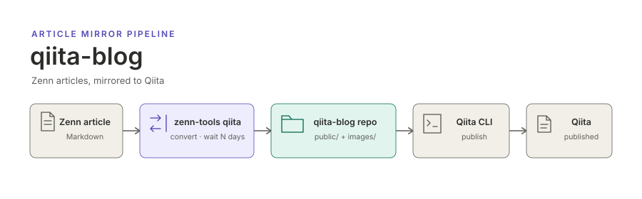

<p align="center"></p>

[English](README.md) | **日本語**

# qiita-blog

[akitenkrad の Zenn の記事](https://zenn.dev/akitenkrad) の Qiita 版です．Zenn で書いた記事のうち Qiita へ展開する印を付けたものを，Zenn での公開から数日後に [Qiita CLI](https://github.com/increments/qiita-cli) の形式へ変換してここに commit し，このリポジトリから [Qiita](https://qiita.com/) へ投稿します．

このリポジトリに書き込むのは自動処理だけです．誤りは Zenn 側の元の記事で直し，次の実行で Qiita へ反映させます．

## 構成

```text
public/   Qiita CLI の記事ファイル (<Zenn の記事 ID>.md)．Qiita が発行した記事 ID もここに書き戻される
images/   記事で使う画像．Qiita にはこのリポジトリから配信する
```

## 仕組み

1. Zenn のリポジトリの GitHub Actions ワークフローが，`main` ブランチへの push のたびと，1 日に 1 回走ります．
2. frontmatter に `qiita: true` を持ち，Zenn で公開してから決まった日数が経った記事を変換し，使っている画像を写します．
3. 変換した記事と画像をここへ push し，`qiita publish --all` で新しい記事を投稿し，変わった記事を更新します．
4. Qiita が発行した記事 ID を `public/` へ commit し直します．これで次の実行は同じ Qiita の記事を更新し，二重に投稿しません．

詳しくは [仕組み](docs/how-it-works.ja.md) を見てください．

## ドキュメント

- [仕組み](docs/how-it-works.ja.md) — 変換，画像の配信，投稿，ここのファイルを手で編集してはいけない理由

## ライセンス

記事と画像は著者の著作物です．Qiita の利用規約で認められる範囲を超えて再利用する許諾は与えていません．
