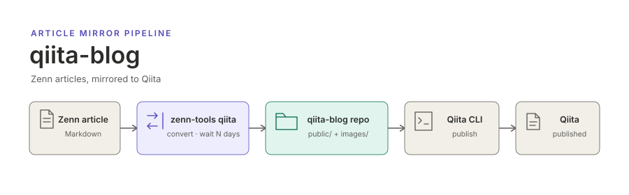

<p align="center"></p>

**English** | [日本語](README.ja.md)

# qiita-blog

The Qiita edition of [akitenkrad's Zenn articles](https://zenn.dev/akitenkrad). Articles written on Zenn that are marked for Qiita are converted to the [Qiita CLI](https://github.com/increments/qiita-cli) format a few days after they are published on Zenn, committed here, and then posted to [Qiita](https://qiita.com/) from this repository.

This repository is written only by automation. Corrections are made to the original article on Zenn and reach Qiita on the next run.

## Layout

```text
public/   Qiita CLI article files (<Zenn article ID>.md); Qiita writes the issued article ID back here
images/   images used by the articles, served to Qiita from this repository
```

## How it works

1. A GitHub Actions workflow in the Zenn repository runs on every push to its `main` branch and once a day.
2. It converts each article whose frontmatter has `qiita: true`, once the article has been published on Zenn for a set number of days, and copies its images.
3. It pushes the converted articles and images here, then runs `qiita publish --all` to post new articles and update changed ones.
4. The article IDs that Qiita issues are committed back to `public/`, so the next run updates the same Qiita article instead of posting a duplicate.

See [How it works](docs/how-it-works.md) for the details.

## Documentation

- [How it works](docs/how-it-works.md) — conversion, image hosting, posting, and why files here must not be edited by hand

## License

The articles and images are the author's own work. No license is granted to reuse them beyond what Qiita's terms allow.
